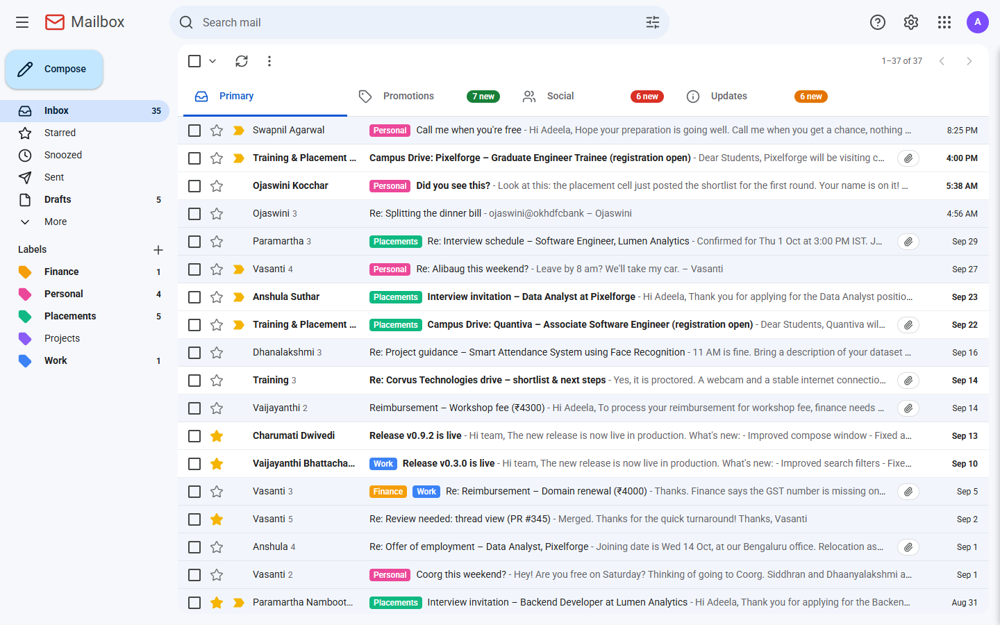
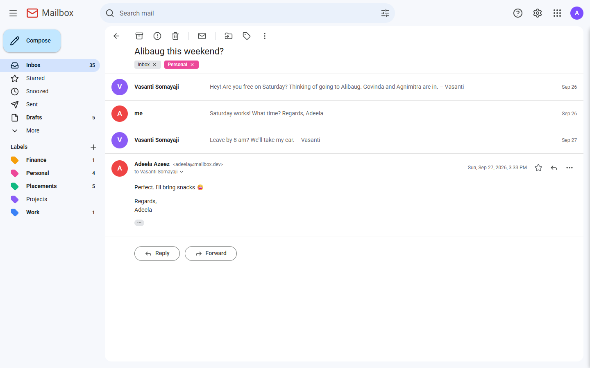
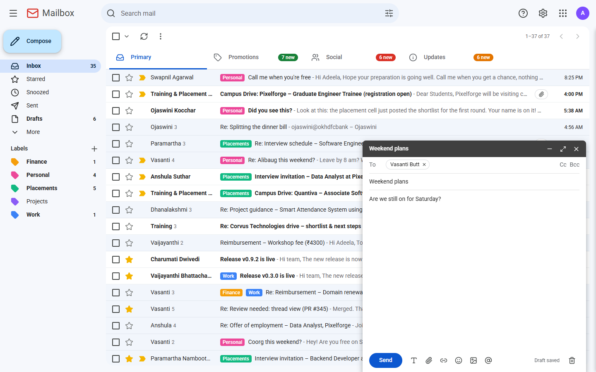
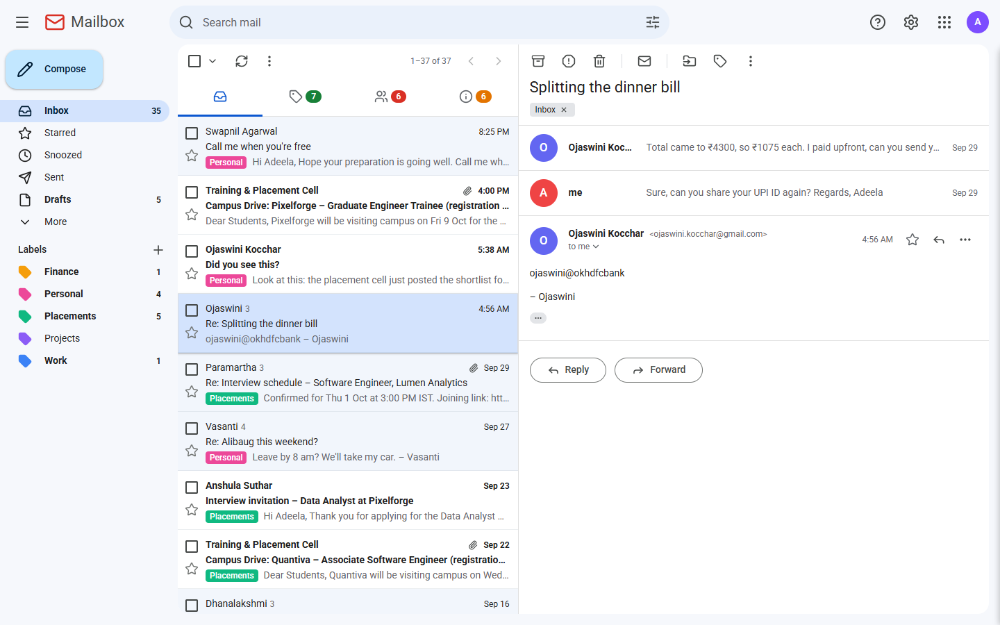
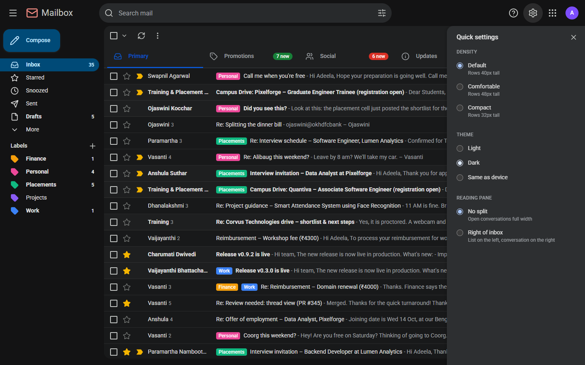
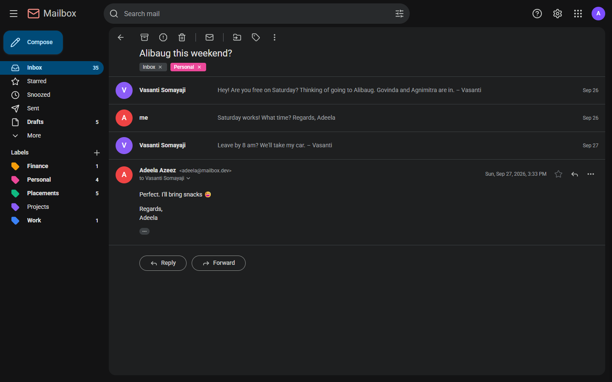
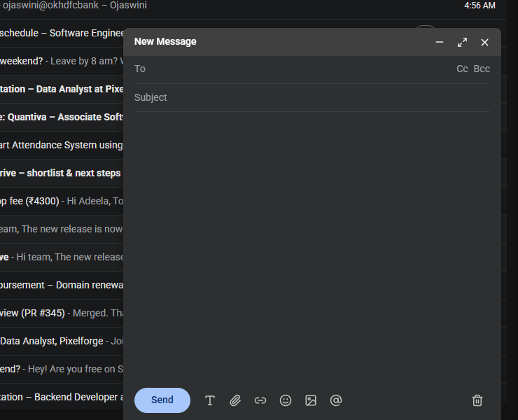
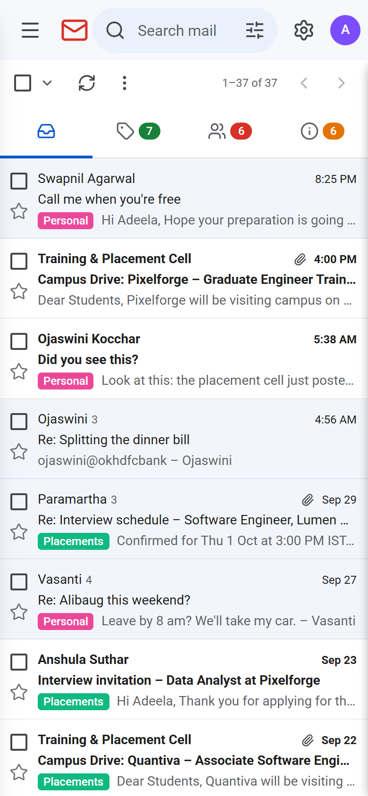
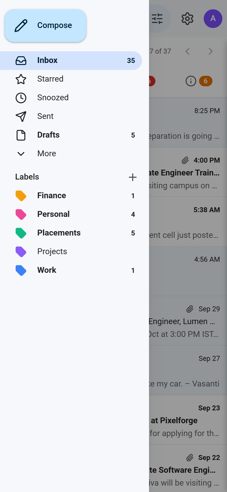
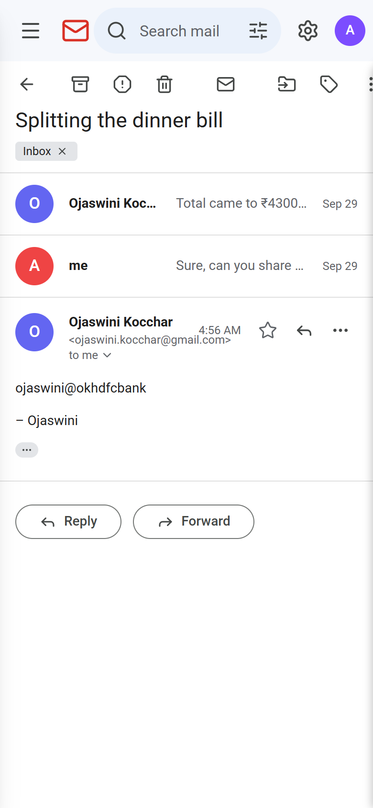

# Mailbox

A Gmail-style email client: a React front end and an Express + SQLite API, in one repo. It ships with seeded data for one signed-in user ("Adeela Azeez"), so there is nothing to configure.



## Features

- **Mail:** inbox with Primary / Promotions / Social / Updates tabs, Starred, Sent, Drafts, Spam, Trash and Archive. The list groups messages into conversations.
- **Reading and replying:** conversation view with collapsed older messages, sanitized HTML bodies, attachment cards, and inline reply / forward.
- **Compose:** up to three popup windows, minimize and fullscreen, recipient autocomplete, draft autosave (every 3 seconds), and a 5-second undo after Send.
- **Search:** `from:`, `to:`, `subject:` and `has:attachment` operators, with a filter panel that builds the query.
- **Labels:** create (name and color), delete, apply and remove from the list and thread toolbars.
- **Bulk actions with Undo:** archive, spam, delete and move-to, all undoable from the toast.
- **Keyboard shortcuts** (press `?` in the app).
- **Settings:** light / dark / system theme, list density, and a reading pane beside the list.
- **Responsive:** under 768px the sidebar is a drawer, list rows stack, and compose is full screen.

## Quick start

Requires Node.js 20.19 or newer (or 22.12+), which Vite 8 needs.

```bash
npm run install:all   # installs the root, server and client dependencies
npm run db:reset      # creates server/data/mail.db and fills it with sample mail
npm run dev           # API on http://localhost:4000, app on http://localhost:5173
```

Open <http://localhost:5173>. Vite proxies `/api` to the server, so there is no CORS setup.

`better-sqlite3` ships prebuilt binaries for common platforms. If `npm install` has to compile it instead, you need a C++ toolchain (Xcode command line tools, `build-essential`, or the Visual Studio Build Tools).

### Scripts

Run from the repository root.

| Command | What it does |
| --- | --- |
| `npm run dev` | Starts the API (nodemon) and the client (Vite) together |
| `npm run db:reset` | Deletes the database, recreates the schema and seeds it |
| `npm run db:seed` | Reseeds the existing database (clears the tables first) |
| `npm run build` | Production build of the client into `client/dist` |

The seed uses a fixed Faker seed (42), so the data is the same every time. Dates are relative to "now" (messages from today, and back 60 days). Set `SEED_NOW=2026-09-30T12:00:00Z` to pin them. Stop the server before `db:reset`, because the database file is open while it runs.

Environment variables: `PORT` changes the API port (default `4000`; update the proxy in `client/vite.config.js` to match).

## Screenshots

| | |
| --- | --- |
|  Conversation view |  Compose window with autocomplete and autosave |
|  Reading pane on the right |  Dark theme with the settings panel |
|  Dark conversation view |  Dark compose window |

On a phone (under 768px):

| | | |
| --- | --- | --- |
|  |  |  |

## Keyboard shortcuts

| Key | Action |
| --- | --- |
| `c` | Compose |
| `/` | Focus search |
| `j` / `k` | Next / previous conversation |
| `o` or `Enter` | Open the conversation |
| `x` | Select the conversation |
| `e` | Archive |
| `#` | Delete |
| `s` | Star / unstar |
| `u` | Back to the list |
| `Shift` + `i` / `Shift` + `u` | Mark as read / unread |
| `?` | Show the shortcut list |

Shortcuts act on the selected rows, or on the row under the cursor. They are off while you type, and inside compose windows, dialogs and open menus.

## Search syntax

```
from:github                      sender name or email contains "github"
to:adeela                        a to/cc recipient matches
subject:"sprint planning"        quote values that contain spaces
has:attachment                   only messages with attachments
interview schedule               plain words (all must match the subject, body or sender)
from:training has:attachment     operators combine (AND)
```

## Project layout

```
.
├── client/                   React + Vite + Tailwind CSS v4
│   └── src/
│       ├── components/       TopBar, Sidebar, SettingsPanel, mail/ (list, row, thread, toolbars), compose/, labels/, ui/
│       ├── context/          Mailbox (counts, labels), Compose (windows, toasts), Settings, Shortcuts
│       ├── hooks/            useMailActions (optimistic mutations + undo), useMediaQuery
│       └── main.jsx          React Query client, error toasts, top-level error boundary
├── server/                   Node + Express 5 + better-sqlite3 (ES modules)
│   ├── db/                   schema.sql, index.js (opens DB, WAL, foreign keys), seed.js, reset.js
│   ├── routes/               mail, threads, drafts, labels, counts, users (+ search and compose helpers)
│   ├── src/index.js          app entry
│   └── data/mail.db          created by db:reset (git-ignored)
└── docs/screenshots/
```

### Data model

`users`, `emails` (one row per message, grouped by `thread_id`), `email_recipients` (to / cc / bcc), `attachments` (metadata only), `labels`, and `mailbox_items`, which is each user's own copy and state of an email (folder, read, starred, important, category). Labels attach to a mailbox item through `mailbox_item_labels`.

## API

Every route is under `/api` and acts as user 1; there is no authentication yet. Errors are JSON, `{ "error": "message" }`, with status 400 (invalid input), 404 (not found) or 409 (conflict). Timestamps are ISO 8601 in UTC.

| Method and path | Purpose |
| --- | --- |
| `GET /api/health` | `{ ok: true }` |
| `GET /api/mail` | Conversation list. Query: `folder` (inbox, sent, drafts, spam, trash, archive, all), `category`, `label` (id), `starred=1`, `q` (search syntax above), `page`, `limit` (1-100, default 50). Returns `{ threads, total, page, limit }`, one row per thread (latest message) with `is_read`, `is_starred`, `labels`, `has_attachment` and `message_count` |
| `GET /api/threads/:threadId` | Every message in a conversation, with recipients, labels and attachments. Marks it read |
| `PATCH /api/mail/:itemId` | Change `is_read`, `is_starred`, `is_important` or `folder` (inbox, spam, trash, archive) |
| `POST /api/mail/bulk` | `{ itemIds \| threadIds, action }`. Actions: `read`, `unread`, `star`, `unstar`, `archive`, `trash`, `spam`, `move` (+ `folder`), `delete`, `label` / `unlabel` (+ `labelId`), `restore` (+ `items: [{ id, folder }]`, the undo for moves) |
| `POST /api/mail/send` | `{ to, cc, bcc, subject, body, threadId?, draftId? }`. Creates the email, a Sent item for you and an Inbox item for each recipient (unknown addresses become users) |
| `POST /api/mail/:itemId/labels` | Apply a label: `{ labelId }` |
| `DELETE /api/mail/:itemId/labels/:labelId` | Remove a label |
| `POST /api/drafts` | Create a draft (all fields optional). Draft ids are mailbox item ids |
| `PUT /api/drafts/:id` | Update a draft (fields left out are kept) |
| `DELETE /api/drafts/:id` | Delete a draft |
| `GET /api/labels` | Your labels with `unread_count` and `total_count` |
| `POST /api/labels` | `{ name, color? }` (409 if the name exists) |
| `DELETE /api/labels/:id` | Delete a label (conversations are kept) |
| `GET /api/counts` | `{ folders, categories, starred }`, each with unread and total conversation counts |
| `GET /api/users?q=&limit=` | Recipient autocomplete |

## Known limits

- Snooze is not implemented: the clock icon does nothing and Snoozed always shows its empty state.
- Attachments are listed (name, type, size) but not stored, so they can't be opened or downloaded, and compose can't attach files.
- There is a single hard-coded user and no sign-in.
- Sent mail is stored and delivered to other users' inboxes in the database only; nothing leaves the machine.
